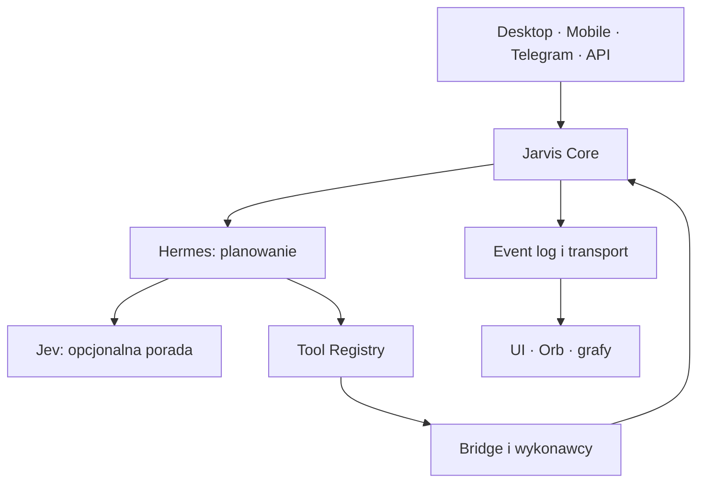

# Architektura docelowa

Status: planned. Nie wybieramy jeszcze frameworka, bazy ani brokera.

## Przepływ jednego zadania

Wejście składa command z client_request_id. Core deduplikuje, zapisuje task i event w jednej granicy trwałości. Hermes dostaje snapshot i katalog, zwraca plan. Core sprawdza zależności i przydziela krok agentowi z lease oraz attempt_id. Tool Registry waliduje schema i uprawnienia; Bridge wykonuje narzędzie i zwraca receipt. Verifier ocenia artefakty i wynik, Core zapisuje przejście verifying → completed albo retry/failed. Transport rozsyła wyłącznie zapisane zdarzenia.

Jev jest optional, nie stoi na jedynej drodze do narzędzi. Timeout, brak usługi, niepoprawny format lub niska pewność przekazują decyzję Hermesowi. Jev nie klika i nie nadaje praw.

## Stan i komunikacja

Core jest jedynym właścicielem task state, attempts, lease, checkpoints i event sequence. Hermes zachowuje własną rozmowę, ale nie drugi niezależny stan tasku. Bridge ma krótkotrwałe wykonanie i receipts z idempotency key. Memory ma osobne namespace i pojedynczego właściciela zapisu.

UI subskrybuje events i pobiera snapshot po reconnect. Cursor i sequence wykrywają lukę; snapshot+replay przywraca spójność. Desktop/Mobile mogą wysłać command, ale nie zapisują task state bezpośrednio. Orb konsumuje projekcję stanów; reduced-motion i odłączenie rendererów nie zmieniają wykonania.

Event Bus oznacza granicę transportu, nie kolejny właściciel prawdy. Outbox i task transition powinny mieć atomową trwałość. Delivery może być at-least-once; konsument deduplikuje event_id. Kolejność gwarantujemy w obrębie task, nie globalnie.

## Bez otwartej przeglądarki

Scheduler, adapter wejścia i worker są procesami niezależnymi od karty. Registry deklaruje UI capability: narzędzie okna może wymagać connected Desktop, ale zapis pliku lub praca backendu nie mogą polegać na SSE klienta. Brak UI daje jawne unavailable/waiting_for_input dla narzędzia zależnego od UI; nie blokuje niezależnych kroków.

Granice modułów: [właściciele](03-MODULE-OWNERSHIP.md). Formaty i statusy: [kontrakty](04-API-AND-EVENT-CONTRACTS.md).
## Living AI Desktop — specyfikacja projektowa (2026-10-11)

**Status:** kierunek Living AI Desktop zatwierdzony przez użytkownika; poniższy szczegółowy projekt jest **draft / do przeglądu**, a wszystkie nowe zdolności runtime są **planned**. Nie jest to zgoda na implementację. Niniejsza sekcja rozszerza istniejącą architekturę, nie tworzy osobnego Core, event busa ani źródła prawdy. Obowiązują [własność modułów](03-MODULE-OWNERSHIP.md), [kontrakty](04-API-AND-EVENT-CONTRACTS.md) i [bramki roadmapy](07-MIGRATION-ROADMAP.md).

### 1. Problem, odbiorca i definicja sukcesu

Odbiorca: użytkownik Windows, który zleca Hermesowi całe rezultaty (np. analizę repo i poprawę błędów), wraca do pracy po przerwie, a z Desktop lub telefonu ogląda rzeczywisty stan. Rozwiązujemy trzy problemy starego UI: zależność wykonania od karty, rozproszoną własność stanu i dekoracyjne animacje bez dowodu.

**Sukces:** w pełnej zintegrowanej fazie 6 jedno zadanie da się zlecić, obejrzeć w Process Log i odtworzyć po odłączeniu klienta, bez podwójnego wykonania skutków; orb i statusy odpowiadają zapisanym faktom. Wcześniejsze fazy dostarczają tylko określone podzbiory tego scenariusza.

**Założenia:** jedna kontrolowana lokalna instalacja jako pierwszy cel; zadania backendowe mogą działać bez otwartej strony. Interakcje z realnym pulpitem Windows mogą wymagać zalogowanej sesji i dostępnego desktop-worker; zamknięta strona nie daje automatycznie możliwości klikania w wyłączony lub zablokowany pulpit. Dostęp z telefonu poza lokalną siecią nie jest automatycznie zagwarantowany.

### 2. Porównanie podejść i wybór

| Podejście | Zaleta | Koszt / ograniczenie | Decyzja |
| --- | --- | --- | --- |
| A. Rozbudować stary frontend jako silnik działań | szybki ekran i animacje | wykonanie i stan dalej zależą od przeglądarki | nie jako fundament |
| B. Local-first Core + cienki klient desktop/web | trwałe zadania, restart, niezależny interfejs, stopniowa migracja | najpierw potrzebna poprawna granica Core i adapterów | **wybrany kierunek** |
| C. Od razu pełna aplikacja natywna | głęboka integracja z Windows | dodatkowe procesy, pakowanie i duży koszt startowy | rozważyć po sprawdzeniu B |

Nie wprowadzamy Kafka/Kubernetes/nowego systemu agentów. React + TypeScript jest kandydatem dla widoku; opcjonalny wrapper Tauri można rozważyć później. Żaden z nich nie jest w tej sekcji zatwierdzonym wyborem narzędzi fazy 1 ani gotową implementacją.

### 3. Granice systemu i właściciel danych

1. **Client adapters (Desktop, Mobile, Telegram, API)** przyjmują intencję; wysyłają command z client_request_id oraz tożsamością źródła. Nie mutują task state bezpośrednio.
2. **Jarvis Core** jest jedynym zapisem tasks, attempts, plan versions, checkpoints, event sequence, dedupe operations i wyników weryfikacji. Atomowo utrwala zmianę oraz event/outbox. W fazie 1 ma to być biblioteka z izolowanym harness, bez UI i bez live narzędzi.
3. **Hermes** proponuje plan i użycie narzędzi. Jego sesja rozmowy nie jest drugim autorytatywnym stanem zadania. **Jev** może klasyfikować intencję tylko opcjonalnie; timeout/brak/niepewność kierują sprawę do Hermesa.
4. **Tool Registry + Workflow + Bridge/Workers** deklarują dostępne zdolności i wykonują zatwierdzone wywołania. Core rozstrzyga revision, lease, deadlines, retries i próby. Tool receipt opisuje efekt: not_started / applied / unknown; unknown wymaga reconciliation, a nie powtórzenia w ciemno.
5. **Verifier** sprawdza artefakty i kryteria sukcesu; tylko Core może zatwierdzić completed.
6. **Event transport** doręcza już utrwalone zdarzenia, co najmniej raz. Nie przechowuje równoległego „prawdziwego” task state.
7. **Living Desktop / Mobile / Orb / Process Log** budują read-only projekcje z snapshotów, eventów i telemetrii. Mogą utrwalać własny układ okien, filtr i preferencje animacji, ale nie status zadania.

**Przepływ:** Command → Core (idempotent create) → Hermes (plan proposal) → Core (lease/dispatch) → Registry/Bridge (effect + receipt) → Core + Verifier (verified transition) → committed Event Log/Outbox → UI projection. UI wysyła nowe commands osobnym kanałem; nigdy nie wpisuje „completed” na podstawie końca animacji.

### 4. Żywy pulpit: odpowiedzialność poszczególnych obszarów

| Obszar referencyjnego HUD | Dane i interakcje | Granica odpowiedzialności |
| --- | --- | --- |
| Centralny orb | stan aktywnego tasku, faza, wybrane zdarzenia, alarm, połączenia | konsumuje tylko potwierdzone eventy/projekcje; nie wywołuje narzędzi bez command |
| Lewa kolumna | health Hermesa, Bridge, Windows, CPU/RAM oraz status dostępności zdolności | osobna telemetria z source i observed_at; UNKNOWN zamiast zmyślonego „online” |
| Prawy Process Log | oś czasu, kroki, błędy, dowody, próby i rozstrzygnięcia | event log/evidence refs; kliknięcie pokazuje źródło |
| Prawa kolumna notatek/zadań | zapisane notatki, zadania, alerty | odrębne moduły/storage, bez fałszywej synchronizacji ze stanem Core |
| Dock i okna | chat, terminal, task detail, graf, ustawienia | tylko client layout state, persistence niezależna od task log |
| Tryby kontekstowe | praca nad repo, agenci, pulpit | prezentacyjna adaptacja przez jawne profile; model nie generuje dowolnych uprzywilejowanych działań z UI |
| Mobile | kompaktowy status, approval i historia tasku | ten sam read model, bez gwarancji pełnego dostępu do Windows |

Wprowadzamy rozdział **fakt / telemetria / prezentacja**. Fakt: „verifier passed”. Telemetria: „ostatni heartbeat Bridge z godziny X”. Prezentacja: „zielony obrót pierścienia”. Brak świeżego heartbeat nie oznacza offline z pewnością; oznacza stale/unknown, dopóki polityka health nie rozstrzygnie inaczej.

### 5. Event-driven cinematic engine i mapowanie stanów

Orb ma cztery warstwy: **A** health infrastruktury, **B** cykl zadania, **C** aktywność narzędzi, **D** ostrzeżenia i wymagany udział użytkownika. Efekt wizualny jest pochodną read model; nie ma własnego lifecycle zadania.

| Źródło zdarzenia/stanu | Efekt w widoku | Zakaz błędnej interpretacji |
| --- | --- | --- |
| task.created / queued | pojawia się nowy task i dyskretny impuls | nie sugerować rozpoczętego wykonania |
| task.transitioned → planning | wolny rytm rdzenia i rozwinięcie planu | brak fałszywego „analiza zakończona” |
| attempt.started / running | impuls do konkretnej zdolności i aktualizacja Process Log | animacja nie jest receipt |
| attempt.receipted → verifying | pierścień kontroli i oczekiwanie na verifier | receipt nie oznacza sukcesu |
| task.verified → completed z passed receipt | zielone potwierdzenie z linkiem do evidence | jedyny triumfalny stan sukcesu |
| waiting_for_input / effect_unknown / recovery_blocked | alert oraz dostępna przyczyna i bezpieczne następne działanie | nie uruchamiać powtórki bez reconciliation |
| failed / cancelled | jawny komunikat i zachowana historia | nie przedstawiać jak completed |
| brak połączenia klienta/health stale | animacje przechodzą w stan degradacji | nie zmieniać task state i nie udawać danych na żywo |

Renderer może korzystać z Motion / GSAP / Canvas / WebGL zależnie od kosztu, ale wszystkie animacje mają identyfikowalny trigger, możliwość wyłączenia oraz działanie w prefers-reduced-motion. Przy spadku wydajności redukujemy liczbę cząstek i FPS, nigdy trwałość Core.

### 6. Odczyt, synchronizacja i odłączony interfejs

- Snapshot zwraca revision/last_sequence. Klient zapisuje osobny cursor per task; pobiera kolejne eventy, ignoruje duplikaty event_id, wykrywa lukę i wykonuje resync. Zdarzenia między snapshotem a subskrypcją odczytuje ponownie po cursor.
- Kolejność jest gwarantowana **per task**, nie globalnie między zadaniami. Powtórne doręczenie nie może odtworzyć komendy ani efektu narzędzia.
- Widok „Time Travel” w późniejszym etapie odtwarza zapisany event log; nie tworzy fikcyjnego stanu z przejściowych klatek animacji. Jeśli retencja wycięła historię, klient jawnie pokazuje zakres niekompletny.
- Core worker, scheduler i adapter Telegram działają poza kartą. Jeżeli wymagana zdolność desktopowa nie istnieje, krok otrzymuje unavailable/waiting_for_input; inne niezależne kroki mogą działać dalej.
- Dane lokalnych preferencji (pozycje okien, dock, tryb wizualny, dostępność) mają oddzielny storage/namespace. Nie zapisują task.status ani task.sequence.

### 7. Kontrakty nowych widoków i ograniczenie danych

Źródłem Core pozostają **C-06 i C-07** z istniejącego rejestru. W fazie 6 projektujemy **pochodny UI read model**, a nie drugą tabelę tasków lub alternatywny event bus. Minimalny zestaw pól projekcji: task_id, revision, last_sequence, status, plan_version, evidence_refs, presentation_reason; każde źródło telemetrii opisujemy co najmniej source, observed_at, health_state i freshness. Dokładny endpoint, format transportu, storage UI i metody odświeżania wymagają osobnej specyfikacji/kontraktów fazy 6.

Nigdy nie przesyłamy w event payload do UI: sekretów, surowych argumentów narzędzi, tokenów, nieoczyszczonych stdout ani prywatnych audit snapshotów. Link do dowodu musi respektować access scope. UI może wyświetlać ujawnione przez Core krótkie powody i referencje dowodów, a nie prywatną treść źródła.

### 8. Błędy, kompromisy i degradacja

- **Zerwane połączenie:** offline/stale panel, zachowany ostatni znany widok z czasem obserwacji; resync po reconnect. Nie zmieniamy statusu zadania na failed tylko z powodu odłączenia UI.
- **Restart Core:** recovery odtwarza trwałe operacje; unknown effect zostaje wstrzymany do rozstrzygnięcia, bez automatycznego retry.
- **Timeout Bridge:** jawny effect_unknown i korelacja invocation_id; UI nie inicjuje ponownej próby samodzielnie.
- **Dublowane/poza kolejnością eventy:** dedupe i snapshot fallback.
- **Niespójny model/telemetria:** read model oznacza brakujące dane jako unknown, nie jako 0%, 60 FPS czy „online”.
- **Zbyt ciężka grafika:** przełącznik 2D/reduced motion, rozdzielenie render loop od event processing; brak wpływu na scheduler.
- **Autonomia:** w zatwierdzonym zakresie Core wykonuje odwracalne działania bez pytań o każdy krok; zewnętrzne i nieodwracalne skutki wynikają z jawnej policy registry oraz weryfikacji. „YOLO” nie oznacza fałszywych receipt ani obchodzenia reconciliation.

### 9. Etapy i granice zatwierdzeń

**Fazy 1–2:** najpierw trwały lifecycle, potem kontrakty Bridge/tool receipts; bez zobowiązania do premium UI. **Fazy 3–5:** pamięć, agenci/workflow i Jev optional zgodnie z istniejącą roadmapą. **Faza 6:** zintegrowany Living Desktop z read model, orb, Process Log, mobile i testami E2E. **Faza 7:** Semantic Zoom, przestrzenne mapy, cyfrowy bliźniak i laboratoria wyłącznie na odrębnych specyfikacjach.

Elementy wyglądu wolno prototypować wcześniej **tylko na jawnych fixtures/replay**, z etykietą DEMO. Nie wolno użyć gotowej animacji jako dowodu akceptacyjnego nowego Core.

### 10. Wymagania testowe i kryteria odbioru

- Kontrakty: te same committed events dają identyczny read model przy live stream oraz snapshot+replay, również przy duplikacji, luce i zmianie kolejności dostarczenia.
- Prawdziwość UI: completed i zielony efekt orb tylko po passed verifier; timeout, unknown oraz brak health pozostają jawne.
- Trwałość: zlecenie z Desktop i Telegram działa headless tam, gdzie tool nie wymaga okna; po restarcie task nie znika i nie powtarza skutku w stanie unknown.
- Desktop/mobile: stan, error i evidence dostępne z klawiatury; sprawdzić 390×844, szeroki ekran, 200% powiększenie i reduced motion.
- Grafika: wykonanie i odtwarzanie logu przy wyłączonym WebGL i odłączonym rendererze; obserwować responsywność i spadki FPS bez narzucania niesprawdzonej gwarancji 60 FPS.
- Telemetria: staleness, offline i unavailable mają obserwowalne źródła i czas; nie wolno syntetyzować procentów CPU/RAM jako live.
- Dowody: fixture testy nie dowodzą live Hermesa/Windows; integracja live wymaga oddzielnego raportu z datą, SHA, logami zredagowanymi i znanymi ograniczeniami.

Szczegółowe scenariusze: [testy i akceptacja](08-TEST-AND-ACCEPTANCE.md). Wszelkie zmiany tej specyfikacji podlegają przeglądowi użytkownika; **nie wolno** uznać jej za zgodę na kodowanie fazy 1 lub 6.
