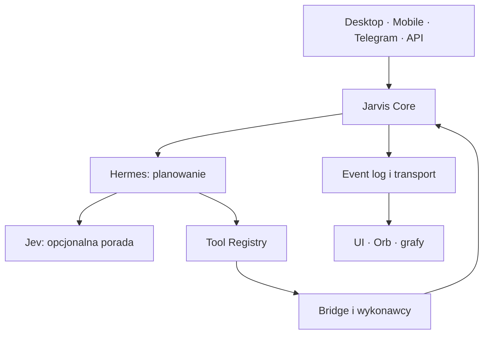

# Architektura docelowa

Status: planned. Nie wybieramy jeszcze frameworka, bazy ani brokera.

## Przepływ jednego zadania

Wejście składa command z client_request_id. Core deduplikuje, zapisuje task i event w jednej granicy trwałości. Hermes dostaje snapshot i katalog, zwraca plan. Core sprawdza zależności i przydziela krok agentowi z lease oraz attempt_id. Tool Registry waliduje schema i uprawnienia; Bridge wykonuje narzędzie i zwraca receipt. Verifier ocenia artefakty i wynik, Core zapisuje przejście verifying → completed albo retry/failed. Transport rozsyła wyłącznie zapisane zdarzenia.

Jev jest optional, nie stoi na jedynej drodze do narzędzi. Timeout, brak usługi, niepoprawny format lub niska pewność przekazują decyzję Hermesowi. Jev nie klika i nie nadaje praw.

## Stan i komunikacja

Core jest jedynym właścicielem task state, attempts, lease, checkpoints i event sequence. Hermes zachowuje własną rozmowę, ale nie drugi niezależny stan tasku. Bridge ma krótkotrwałe wykonanie i receipts z idempotency key. Memory ma osobne namespace i pojedynczego właściciela zapisu.

UI subskrybuje events i pobiera snapshot po reconnect. Cursor i sequence wykrywają lukę; snapshot+replay przywraca spójność. Desktop/Mobile mogą wysłać command, ale nie zapisują task state bezpośrednio. Orb konsumuje projekcję stanów; reduced-motion i odłączenie rendererów nie zmieniają wykonania.

Event Bus oznacza granicę transportu, nie kolejny właściciel prawdy. Outbox i task transition powinny mieć atomową trwałość. Delivery może być at-least-once; konsument deduplikuje event_id. Kolejność gwarantujemy w obrębie task, nie globalnie.

## Bez otwartej przeglądarki

Scheduler, adapter wejścia i worker są procesami niezależnymi od karty. Registry deklaruje UI capability: narzędzie okna może wymagać connected Desktop, ale zapis pliku lub praca backendu nie mogą polegać na SSE klienta. Brak UI daje jawne unavailable/waiting_for_input dla narzędzia zależnego od UI; nie blokuje niezależnych kroków.

Granice modułów: [właściciele](03-MODULE-OWNERSHIP.md). Formaty i statusy: [kontrakty](04-API-AND-EVENT-CONTRACTS.md).
